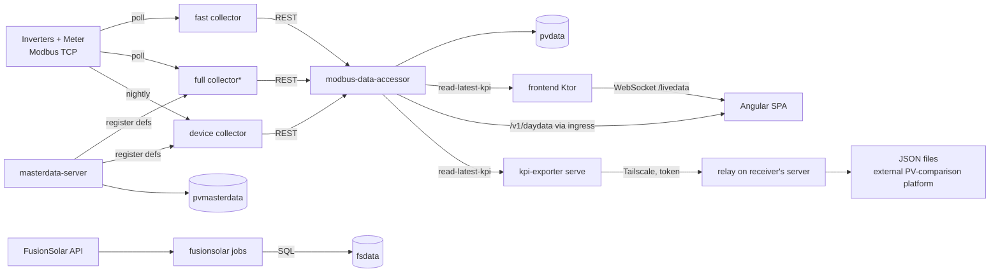

# PVLogger — Context

This document describes PVLogger at the **stable** level: purpose, domain language,
component responsibilities, and data flow. Volatile detail (versions, build
commands, layouts) lives in [CLAUDE.md](CLAUDE.md). Decisions are in
[docs/adr/](docs/adr/), known inconsistencies in
[docs/CONSOLIDATION-BACKLOG.md](docs/CONSOLIDATION-BACKLOG.md), undocumented
knowledge in [docs/OPEN-QUESTIONS.md](docs/OPEN-QUESTIONS.md), and open security
findings in [docs/SECURITY-FINDINGS.md](docs/SECURITY-FINDINGS.md). How this repo relates
to the `infrastructure` repo and the legacy folders:
`infrastructure/docs/LANDSCAPE.md`.

> Marker convention: `⚠️ GAP` = knowledge only the operator has. Answer it, move
> the answer here or into an ADR, delete the marker.

## Purpose

PVLogger monitors a private **photovoltaic installation** (2× Huawei
SUN2000-8KTL-M1 inverters, Huawei DTSU666-H smart meter, Modbus TCP via a
SmartDongle). It:

- polls the inverters/meter over **Modbus TCP** (once per minute),
- pulls portal data from the **Huawei FusionSolar OpenAPI**,
- stores everything in PostgreSQL,
- computes household energy **KPIs**,
- serves a **dashboard** (live via WebSocket + per-day history),
- exports the latest KPI snapshot as JSON to an external PV-comparison
  platform run by a third party (pulled over Tailscale by a relay on the receiver's server, ADR-0021),
- and feeds a **battery simulator** used to evaluate a LUNA2000 battery purchase
  (2026 verdict: not economical yet — purchase deferred, simulator kept for
  re-evaluation when prices change; ADR-0006).

It runs as microservices on the homelab K3S cluster. The Helm chart lives in this
repo (`deploy/helm/pvlogger/`); the `infrastructure` repo holds the **site values**
and runs the install (ADR-0024; the move is backlog item 52).
The microservice architecture was learning-driven; new services must justify
themselves pragmatically — default to a job/endpoint in an existing service
(ADR-0007).

## Domain vocabulary

- **Device** — a Modbus logic device addressed by unit ID. Exactly two types:
  `METER` and `INVERTER`. Current site: meter ID `1`, inverter IDs `1,16`.
  Physical topology behind the IDs: the **SmartDongle** (`<dongle-ip>`) is
  the Modbus TCP gateway, physically plugged into inverter `1`; inverter `16`
  (the second SUN2000-8KTL-M1) is RS485 daisy-chained to inverter `1` and
  reached through the same dongle. The meter at ID `1` is a **virtual
  device**: the DTSU666-H is wired to inverter `1` via RS485 and has no unit
  ID of its own — its readings are exposed in the meter register block of
  unit `1`, so meter and inverter `1` share a unit ID and are distinguished
  only by register addresses.
- **Register** — a Modbus holding register described by a *register definition*:
  address, quantity, type (U16/U32/I16/I32/STR/…), gain, unit, and a **category**:
  `STATIC` (nameplate data), `DYNAMIC` (measurements), `CONFIG`, `ALARM`, `DEVLST`.
  `Category.DEVLST` and `Type.MLD` are currently unhandled **by design** — the
  `NotImplementedError` in the data accessor is a deliberate fail-fast guard so a
  future feature that receives such data cannot silently skip it. `DEVLST` is
  loosely planned for implementation one day (confirmed 2026-08-07).
- **Master data** — the register definitions themselves: Huawei's imported
  from three SUN2000 CSV files, project-curated ones (the DONGLE block) added
  by Flyway data migration (ADR-0017); served over REST.
- **Raw KPI register values** — the per-minute raw snapshot row (one per fast
  run): inverter active power, meter active power, inverter daily yield,
  inverter accumulated (lifetime) yield, meter exported energy, meter imported
  energy. Its lifetime counters feed the accessor's day-delta endpoint
  (ADR-0014); the live KPI values are read back per run from the dongle block
  in the generic register store (ADR-0016).
- **KPI** — derived household energy figures. Two naming vocabularies exist and
  map 1:1 (the mapping is documented in `PvLoggerKpiData.kt`):

  | Compute/wire name (Go) | Storage/REST name | German (export/docs) |
  |---|---|---|
  | producing / produced | solar_power / daily_energy_yield | prod |
  | exporting / exported | solar_to_grid_power / daily_energy_exported | exp / verk |
  | importing / imported | grid_to_house_power / daily_energy_imported | imp / kauf |
  | consuming / consumed | own_consumption / daily_energy_consumed | verbr / verb |
  | selfConsuming / selfConsumed | solar_to_house_power / daily_energy_self_covered | eigv |

  Derivations (`pvlogger-shared-modbus/kpis/`): `consuming = producing − exporting
  + importing`; `selfConsuming = producing − exporting`.
- **Live data** — the latest KPI row, pushed to the browser over the `/livedata`
  WebSocket. The frontend polls the data accessor once every 60 s and fans the
  result out to all connected sessions; polling runs only while at least one
  browser is connected (ADR-0019).
- **Chart version** — one release of the pvlogger Helm chart, tagged
  `chart/vX.Y.Z`: its templates plus the pinned image version of every
  component. It is what an installation deploys (ADR-0024).
  _Avoid_: "release" alone (ambiguous with a component's image version).
- **Site values** — what only one installation knows (hosts, device IDs,
  accounts, secrets, ingress names). They never enter this repo; this
  installation's site values live in the private `infrastructure` repo.
  _Avoid_: "config" (the chart's generic defaults are config too).

## Component map

### Kotlin/Ktor HTTP services (long-running)

| Service | Responsibility |
|---|---|
| `pvlogger-modbus-data-accessor` | **The central data service.** Owns the `pvdata` DB (register values, raw KPI registers, house KPIs). All collectors write through it; frontend and exporter read from it. REST paths are defined in `pvlogger-shared-rest`. |
| `pvlogger-masterdata-server` | Owns the `pvmasterdata` DB. Imports Huawei's register definitions from CSVs; project-curated definitions (the DONGLE unit-100 block) ship as Flyway data migrations instead (ADR-0017). Serves the catalog to the collectors. |
| `pvlogger-frontend` | Serves the prebuilt Angular SPA, proxies the latest KPI as the `/livedata` WebSocket (one shared 60 s poll for all sessions, ADR-0019). History data goes **directly** SPA → data accessor (via the ingress, which passes only `/v1/daydata` of the data accessor — ADR-0020). |

### Go CronJob collectors (short-lived batch runs)

| Service | Responsibility |
|---|---|
| `pv-fast-data-collector` | **Single CronJob, `0-1,5-59 * * * *`** — minutes 02–04 of every hour are the reserved non-fast Modbus window (ADR-0016/backlog 36: hour 0 for the nightly device collectors, hours 1–23 for full's hourly sweep). Reads the dongle's aggregate live-power block (unit 100, one coherent request — backlog 33) plus the energy counters, stores the block in the generic register store and the raw KPI row, then invokes the **shared `aggregate(jobId)` path** (`pvlogger-shared-modbus/aggregate`, ADR-0016/backlog 34) which derives and stores the KPIs (daily production as a lifetime-counter delta, ADR-0014). **The sole per-minute KPI collector** — registers are hard-coded *deliberately* for maximum speed (no masterdata dependency/API call; the set lives in `pvlogger-shared-modbus/registers`). |
| `pv-full-data-collector` | The masterdata-driven **extended sweep**: reads *all* DYNAMIC+ALARM registers — including the dongle's unit-100 block as one consecutive Modbus request (backlog 35, migration V2 + DONGLE device type) — then invokes the same shared `aggregate(jobId)` path as fast; its private aggregator was deleted (ADR-0016/backlog 34). Runs **hourly at minute 2 of hours 1–23** inside the reserved 02–04 window, `activeDeadlineSeconds: 150` so an overrun dies before fast's minute-5 reconnect (backlog 36; the old suspend toggle and its chart bug were removed with it). No KPI role of its own — its KPI rows just fill fast's window gap. Needs masterdata migration V2 (the DONGLE block); live together since 2026-08-14. |
| `pv-device-data-collector` | Nightly: reads STATIC/CONFIG registers, device identifiers and device list. Stays permanently; scheduled at night to avoid the per-minute dynamic polling (one-Modbus-client constraint, ADR-0004). |
| `pvlogger-fusionsolar` | Six scheduled jobs pulling FusionSolar OpenAPI KPIs (station/device, real-time/day/month/year) — writes **directly** to the `fsdata` DB (not via the data accessor). |
| `pvlogger-fusionsolar-auth` | Refreshes the FusionSolar API token into a K8s secret every 20 min; the collector jobs read it. |
| `pvlogger-kpi-exporter` | Builds a German-keyed JSON file (`pv_*`, the receiver's key prefix and part of its contract) from the latest KPI. One binary, three modes (ADR-0021, infrastructure ADR-0024): `serve` (Deployment, token-protected `GET /v1/export/latest`, reached over Tailscale) and `relay` (a systemd service on the receiver's server that fetches from `serve` and writes the files there) carry the export since 2026-10-23. `export` is the old file-writing path: the mode is still in the code and is still the default, but nothing deploys it since its CronJob, NFS volume and the OneDrive sync were removed (backlog 44). Consumed by a third party (the receiver), who runs a small platform comparing the energy/PV data of several private PV installations. This is an **external consumer** — treat the file naming, keys, and 5-min cadence as a de-facto contract. |

### Shared libraries

Kotlin: `pvlogger-shared-model` (Modbus domain model), `pvlogger-shared-rest`
(REST path constants + KPI DTO), `pvlogger-shared-database` (Hikari + Flyway
bootstrap), `pvlogger-shared-ktor` (HTTP service bootstrap: CallLogging/CallId,
Prometheus `/metrics`, StatusPages, shared `PvHttpClient` — ADR-0018). Go: `pv-logger` (logging, env
config), `pvlogger-shared-modbus`
(hand-rolled Modbus TCP client, KPI math, masterdata/persistence REST clients,
register/device-identifier collector jobs, Pushgateway metrics, the hard-coded
KPI register set in `registers`, and the single KPI aggregation path in
`aggregate` — ADR-0016).

### Tools (not deployed)

`pvlogger-battery-simulator` — local CLI replaying historical KPI data against
simulated LUNA2000 batteries (deliberately no Docker/K8s; see its README).
Purchase deferred as uneconomical (2026); the CLI stays as the standing
re-evaluation tool (ADR-0006).
`pvlogger-database/` — local Docker Compose Postgres + historical migration
runbooks; not a service.
`pvlogger-modbus-mock` — the **synthetic plant**: one deterministic model of a
generic 10 kWp plant and household, served over Modbus TCP in place of the
SmartDongle so the real collectors run against it. **Local development only —
never deployed to production** (confirmed 2026-08-07); the chart's mock template
is off by default (ADR-0025).

## Data flow

\* full collector: hourly sweep at minute 2 of hours 1–23 (ADR-0016).

Rule: **all Modbus-derived data flows through the data accessor's REST API** —
collectors never touch `pvdata` directly. The FusionSolar pipeline is the
exception: it writes its own `fsdata` DB directly. ⚠️ GAP: deliberate exception
or drift? (`fsdata`'s migrations, by contrast, are settled: dropped in the Kotlin→Go
rewrite — see ADR-0002 — and reintroduced as tern migrations, ADR-0022.)

## Databases

Since 2026-10-25 the three PVLogger databases live in the in-cluster CloudNativePG
cluster `pvlogger-db` (namespace `pvlogger`, three instances; infrastructure ADR-0022).
Services connect to `pvlogger-db-rw` with TLS required (`sslmode=require`); the
battery simulator reads from the standbys at `<db-host>:5432` (LAN only).
Before that they were on the central server (`<central-host>:5434`), which
still serves other homelab apps; its PVLogger copies are dropped around 2026-11-01.
Database roles are managed by CloudNativePG; migrations only GRANT to them (ADR-0023).
Each database is owned by exactly one service, which also owns its migrations (Flyway; tern for `fsdata`):

| DB | Owner | Content |
|---|---|---|
| `pvdata` | modbus-data-accessor | register values, raw KPI registers, house KPIs |
| `pvmasterdata` | masterdata-server | register definitions |
| `fsdata` | fusionsolar (tern migrations, manual `MIGRATE` job — ADR-0022) | FusionSolar responses & KPIs |

All three are dumped nightly by the chart's db-backup CronJob (`dbBackup.enabled`, set in the site values). A fourth,
`sunrisesunset`, was dropped on 2026-08-27 with the retirement of its module (ADR-0005).

## Build, versioning & deployment (summary)

- Images are built by `scripts/build.sh` and pushed to the private registry
  `<registry-host>:5000` (`DOCKER_REGISTRY`, set outside the repo in
  `~/.config/pvlogger/local.env`). **A service's version is the `LABEL version` in its
  Dockerfile** ([ADR-0003](docs/adr/0003-image-versioning-and-deployment.md)).
- **Deployed** versions are pinned in the chart's `values.yaml` in this repo; a
  **chart version** (`chart/vX.Y.Z`) names that set, and the infrastructure repo
  pins the chart version it installs (ADR-0024, supersedes the deployment part
  of ADR-0003; backlog item 52 carries out the move).
- Generic defaults (ports, schedules, resources) are chart defaults; **site
  values** (Modbus host `<dongle-ip>`, device IDs, DB endpoints, secrets) stay in
  the infrastructure repo.
- Local dev: `tilt up` per CLAUDE.md — the **intended environment for developing
  larger changes** (confirmed 2026-08-07). It deploys this chart with
  `deploy/dev/values-dev.yaml` and locally built images, plus a plain dev
  PostgreSQL, the synthetic plant's Modbus mock and its history backfill
  (ADR-0025, backlog items 23 and 30).
