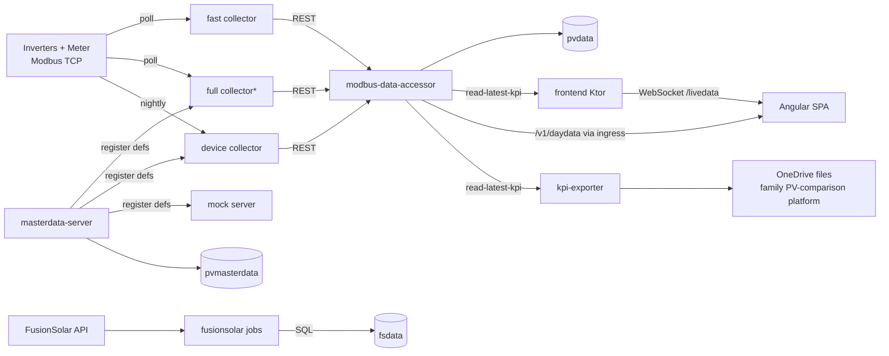

# PVLogger — Context

This document describes PVLogger at the **stable** level: purpose, domain language,
component responsibilities, and data flow. Volatile detail (versions, build
commands, layouts) lives in [CLAUDE.md](CLAUDE.md). Decisions are in
[docs/adr/](docs/adr/), known inconsistencies in
[docs/CONSOLIDATION-BACKLOG.md](docs/CONSOLIDATION-BACKLOG.md), and undocumented
knowledge in [docs/OPEN-QUESTIONS.md](docs/OPEN-QUESTIONS.md). How this repo relates
to the `infrastructure` repo and the legacy folders:
`infrastructure/docs/LANDSCAPE.md`.

> Marker convention: `⚠️ GAP` = knowledge only the operator has. Answer it, move
> the answer here or into an ADR, delete the marker.

## Purpose

PVLogger monitors a private **16 kWp photovoltaic installation** (2× Huawei
SUN2000-8KTL-M1 inverters, Huawei DTSU666-H smart meter, Modbus TCP via a
SmartDongle — see `Batteriespeicher_Projekt_Zusammenfassung.md` for the site
description, in German). It:

- polls the inverters/meter over **Modbus TCP** (once per minute),
- pulls portal data from the **Huawei FusionSolar OpenAPI**,
- stores everything in PostgreSQL,
- computes household energy **KPIs**,
- serves a **dashboard** (live via WebSocket + per-day history),
- exports KPI snapshots as JSON files (OneDrive-synced),
- and feeds a **battery simulator** used to evaluate a LUNA2000 battery purchase.

It runs as microservices on the homelab K3S cluster; deployment is owned by the
`infrastructure` repo (Helm chart under `ansible/roles/pvlogger_helm_deploy/`).

## Domain vocabulary

- **Device** — a Modbus logic device addressed by unit ID. Exactly two types:
  `METER` and `INVERTER`. Current site: meter ID `1`, inverter IDs `1,16`.
  Physical topology behind the IDs: the **SmartDongle** (`<dongle-ip>`) is
  the Modbus TCP gateway, physically plugged into inverter `1`; inverter `16`
  (the second SUN2000-8KTL-M1) is RS485 daisy-chained to inverter `1` and
  reached through the same dongle. The meter at ID `1` is a **virtual
  device**: the DTSU666-H is wired to inverter `1` via RS485 and has no unit
  ID of its own — its readings are exposed in the meter register block of
  unit `1`, so meter and inverter `1` share a unit ID and are distinguished
  only by register addresses.
- **Register** — a Modbus holding register described by a *register definition*:
  address, quantity, type (U16/U32/I16/I32/STR/…), gain, unit, and a **category**:
  `STATIC` (nameplate data), `DYNAMIC` (measurements), `CONFIG`, `ALARM`, `DEVLST`.
- **Master data** — the register definitions themselves, imported from three
  Huawei SUN2000 CSV files into the masterdata database and served over REST.
- **Raw KPI register values** — the five per-minute register readings the KPI
  computation is based on: inverter active power, meter active power, inverter
  daily yield, meter exported energy, meter imported energy.
- **KPI** — derived household energy figures. Two naming vocabularies exist and
  map 1:1 (the mapping is documented in `PvLoggerKpiData.kt`):

  | Compute/wire name (Go) | Storage/REST name | German (export/docs) |
  |---|---|---|
  | producing / produced | solar_power / daily_energy_yield | prod |
  | exporting / exported | solar_to_grid_power / daily_energy_exported | exp / verk |
  | importing / imported | grid_to_house_power / daily_energy_imported | imp / kauf |
  | consuming / consumed | own_consumption / daily_energy_consumed | verbr / verb |
  | selfConsuming / selfConsumed | solar_to_house_power / daily_energy_self_covered | eigv |

  Derivations (`pvlogger-shared-modbus/kpis/`): `consuming = producing − exporting
  + importing`; `selfConsuming = producing − exporting`.
- **Live data** — the latest KPI row, pushed to the browser over the `/livedata`
  WebSocket (refreshed every 60 s).

## Component map

### Kotlin/Ktor HTTP services (long-running)

| Service | Responsibility |
|---|---|
| `pvlogger-modbus-data-accessor` | **The central data service.** Owns the `pvdata` DB (register values, raw KPI registers, house KPIs). All collectors write through it; frontend and exporter read from it. REST paths are defined in `pvlogger-shared-rest`. |
| `pvlogger-masterdata-server` | Owns the `pvmasterdata` DB. Imports register definitions from CSVs, serves them to collectors and the mock server. |
| `pvlogger-frontend` | Serves the prebuilt Angular SPA, proxies the latest KPI as the `/livedata` WebSocket. History data goes **directly** SPA → data accessor (via ingress path `/v1`). |
| `pvlogger-sunrise-sunset` | Fetches and caches sunrise/sunset times for the site coordinates (own `sunrisesunset` DB). |
| `pvlogger-modbus-mock-server` | Emulates a Modbus TCP device (raw TCP, not HTTP) using real register definitions from the masterdata server. For development. ⚠️ GAP: is it ever deployed to the real cluster? The Helm chart can deploy it. |

### Go CronJob collectors (short-lived batch runs)

| Service | Responsibility |
|---|---|
| `pv-fast-data-collector` | Every minute: reads 5 hard-coded registers, stores raw values, computes and stores live+today KPIs. **The default Modbus collector** — registers are hard-coded *deliberately* for maximum speed (no masterdata dependency/API call; ADR-0004). |
| `pv-full-data-collector` | Reads *all* DYNAMIC+ALARM registers (definitions from masterdata), then aggregates KPIs. The **manually-toggled permanent alternative** to the fast collector — exactly one of the two runs, because the Modbus endpoint allows only one client (ADR-0004). **Currently permanently suspended by a chart bug** (see infrastructure backlog #2), which defeats the intended manual toggle. |
| `pv-device-data-collector` | Nightly: reads STATIC/CONFIG registers, device identifiers and device list. Stays permanently; scheduled at night to avoid the per-minute dynamic polling (one-Modbus-client constraint, ADR-0004). |
| `pvlogger-fusionsolar` | Six scheduled jobs pulling FusionSolar OpenAPI KPIs (station/device, real-time/day/month/year) — writes **directly** to the `fsdata` DB (not via the data accessor). |
| `pvlogger-fusionsolar-auth` | Refreshes the FusionSolar API token into a K8s secret every 20 min; the collector jobs read it. |
| `pvlogger-kpi-exporter` | Every 5 min: reads the latest KPI and writes a German-keyed (`pv_*`) JSON file to an NFS/OneDrive-synced volume. Consumed by the operator's receiver: he runs a small platform comparing the energy/PV data of three family households (operator, another household, his own). This is an **external consumer** — treat the file naming, keys, and 5-min cadence as a de-facto contract. |

### Shared libraries

Kotlin: `pvlogger-shared-model` (Modbus domain model), `pvlogger-shared-rest`
(REST path constants + KPI DTO), `pvlogger-shared-database` (Hikari + Flyway
bootstrap). Go: `pv-logger` (logging, env config), `pvlogger-shared-modbus`
(hand-rolled Modbus TCP client, KPI math, masterdata/persistence REST clients).

### Tools (not deployed)

`pvlogger-battery-simulator` — local CLI replaying historical KPI data against
simulated LUNA2000 batteries (deliberately no Docker/K8s; see its README).
`pvlogger-database/` — local Docker Compose Postgres + historical migration
runbooks; not a service.

## Data flow

\* full collector currently suspended (chart bug).

Rule: **all Modbus-derived data flows through the data accessor's REST API** —
collectors never touch `pvdata` directly. The FusionSolar pipeline is the
exception: it writes its own `fsdata` DB directly. ⚠️ GAP: deliberate exception
or drift? (`fsdata` also has no Flyway migrations — its schema exists only in the
running DB and old dumps.)

## Databases

One PostgreSQL server (the homelab central server) hosts four databases. Each is
owned by exactly one service, which also owns its Flyway migrations:

| DB | Owner | Content |
|---|---|---|
| `pvdata` | modbus-data-accessor | register values, raw KPI registers, house KPIs |
| `pvmasterdata` | masterdata-server | register definitions |
| `sunrisesunset` | sunrise-sunset | cached sun times |
| `fsdata` | fusionsolar (no migrations — ⚠️ GAP above) | FusionSolar responses & KPIs |

All four are dumped nightly by the db-backup CronJob (infrastructure repo).

## Build, versioning & deployment (summary)

- Images are built by `scripts/build.sh` and pushed to the private registry
  `<registry-host>:5000`. **A service's version is the `LABEL version` in its
  Dockerfile** ([ADR-0003](docs/adr/0003-image-versioning-and-deployment.md)).
- **Deployed** versions are pinned in the Helm chart's `values.yaml` in the
  infrastructure repo (declared single source of truth for what runs).
- Cron schedules and runtime config (Modbus host `<dongle-ip>`, device IDs,
  DB endpoints) live in the chart/Ansible role, not here.
- Local dev: `tilt up` per CLAUDE.md — ⚠️ GAP: the Tiltfile references a
  `pvlogger-infrastructure/` directory that no longer exists and has no
  `docker_build` steps; it likely predates the move to the Helm chart. Verify
  whether the Tilt flow still works before relying on it.
