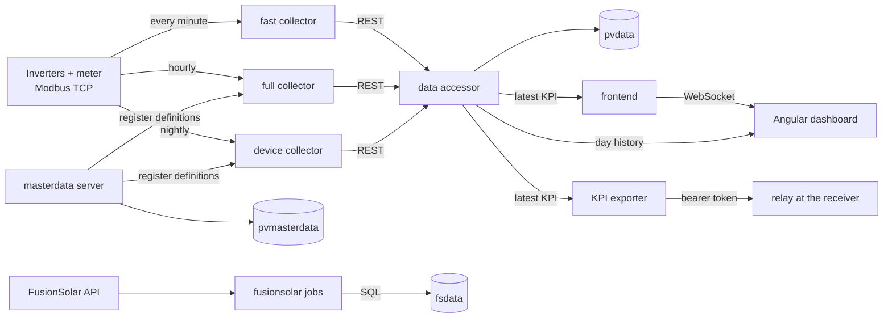

# PVLogger

[](https://github.com/ziswb/pvlogger-msa/actions/workflows/jvm.yml)
[](https://github.com/ziswb/pvlogger-msa/actions/workflows/go.yml)
[](https://github.com/ziswb/pvlogger-msa/actions/workflows/frontend.yml)
[](https://github.com/ziswb/pvlogger-msa/actions/workflows/chart.yml)
[](https://github.com/ziswb/pvlogger-msa/actions/workflows/images.yml)
[](https://github.com/ziswb/pvlogger-msa/actions/workflows/gitleaks.yml)
[](LICENSE)

Monitoring and data collection for a home photovoltaic installation (Huawei SUN2000
inverters), built as a small polyglot microservice system on Kubernetes.

- **Collects** inverter and meter registers over Modbus TCP every minute and derives
  energy-flow KPIs (solar to house, grid import/export, self-consumption).
- **Integrates** the Huawei FusionSolar Northbound API as a second, cloud-side source.
- **Serves** an Angular dashboard with live data over WebSocket and daily history.
- **Exports** the latest KPIs to a third party through a token-protected endpoint.
- **Simulates** a home battery against the measured history before buying one
  ([battery simulator](pvlogger-battery-simulator/README.md)).

> Status: personal project, running in production on a home k3s cluster.

## Architecture

Kotlin/Ktor services hold the data and serve the UI; Go CronJobs do the collecting.



| Component | Language | Role |
|---|---|---|
| `pv-fast-data-collector` | Go | per-minute Modbus poll of the KPI registers |
| `pv-full-data-collector` | Go | hourly sweep of all registers in the master data |
| `pv-device-data-collector` | Go | nightly static/device-identifier registers |
| `pvlogger-modbus-data-accessor` | Kotlin | stores and queries register values and KPIs |
| `pvlogger-masterdata-server` | Kotlin | Modbus register master data |
| `pvlogger-frontend` | Kotlin + Angular | dashboard SPA and `/livedata` WebSocket |
| `pvlogger-fusionsolar`, `-auth` | Go | FusionSolar API integration |
| `pvlogger-kpi-exporter` | Go | token-protected KPI export |
| `pvlogger-modbus-mock` | Go | local development only: a synthetic plant over Modbus TCP and its history backfill |

Everything deploys with one Helm chart, [`deploy/helm/pvlogger`](deploy/helm/pvlogger/README.md),
which pins every image version.

See [CONTEXT.md](CONTEXT.md) for the domain vocabulary and data flow, and
[docs/adr/](docs/adr/) for the decisions behind it.

## Engineering notes

- **Decisions are written down.** 27 [ADRs](docs/adr/), a
  [consolidation backlog](docs/CONSOLIDATION-BACKLOG.md) of verified defects and
  divergences, [open questions](docs/OPEN-QUESTIONS.md) and
  [security findings](docs/SECURITY-FINDINGS.md), open ones included. References
  to "infrastructure ADR/backlog N" point to the private repository that holds the
  site configuration.
- **Tests against the real thing.** JVM services test against PostgreSQL 18 in
  Testcontainers ([ADR-0009](docs/adr/0009-data-accessor-tests-on-real-postgresql.md)), never
  an in-memory stand-in; DST and time-zone edge cases have their own regression tests.
- **A deterministic synthetic plant** ([ADR-0025](docs/adr/0025-synthetic-plant-in-go-mock-and-backfill.md))
  replaces the inverter in development: the same Go model serves Modbus TCP and
  backfills 30 days of history, so the dashboard shows realistic data on a laptop.
- **Hardened deployment.** One Helm chart pins every image version; workloads run
  non-root with a read-only root filesystem, no capabilities and seccomp
  `RuntimeDefault`; default-deny NetworkPolicies and an ingress allowlist
  ([ADR-0020](docs/adr/0020-trust-boundary-ingress-allowlist.md)); base images and
  CI actions are pinned by digest/SHA.
- **One tag releases everything.** Pushing `chart/vX.Y.Z` publishes every image the
  chart pins, for amd64 and arm64, and the chart itself to GHCR; released
  versions are never overwritten
  ([ADR-0027](docs/adr/0027-chart-tag-publishes-images-and-chart-to-ghcr.md)).
- **Public code, private configuration**, enforced by a three-layer leak guard
  (see below).
- **AI-assisted.** Much of the recent work was done with Claude Code as a pair
  programmer; [CLAUDE.md](CLAUDE.md) holds its project instructions, and the
  commits it co-wrote say so in a `Co-Authored-By` trailer.

## Build

```bash
./gradlew build                     # JVM services (tests need Docker for Testcontainers)
./gradlew makeGoBuild               # Go services (each module: make test / make lint)
cd pvlogger-frontend/src/web && npm ci && npm run build:ci   # Angular SPA
```

## Try it locally

With [Rancher Desktop](https://rancherdesktop.io/) (Kubernetes and Traefik on) and
[Tilt](https://tilt.dev/):

```bash
tilt up --context rancher-desktop
```

This builds every image, installs the chart with a dev database and a synthetic PV
plant in place of the real inverter, writes 30 days of history, and serves the
dashboard on `http://localhost/`. It works on arm64 and amd64 hosts.

## Contributing

Enable the leak-guard hooks once per clone (this repository is public; see
[`.githooks/README.md`](.githooks/README.md)):

```bash
git config core.hooksPath .githooks
```

Security issues: see [SECURITY.md](SECURITY.md).

## Public code, private configuration

This repository contains no site configuration. Hosts, network details, site
identifiers and credentials live in a separate private infrastructure repository and
appear here only as placeholders such as `<db-host>` or `<tailnet>`.

## License

Apache License 2.0, see [LICENSE](LICENSE) and [NOTICE](NOTICE).

Not affiliated with or endorsed by Huawei. Huawei, FusionSolar and SUN2000 are
trademarks of Huawei Technologies Co., Ltd.
